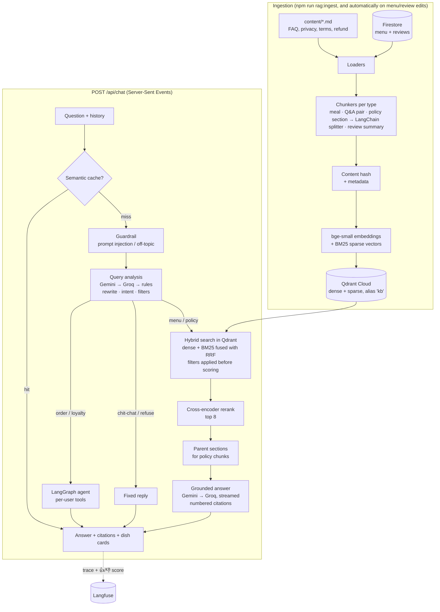

# The Flavor Alchemist — support chatbot (RAG)

A retrieval-augmented generation (RAG) assistant built into the food-ordering app. It answers menu,
delivery, payment and policy questions from the site's own content, with citations; recommends dishes
as "Add to cart" cards; and answers signed-in customers' order and loyalty questions through tools.
Everything runs on free tiers: Qdrant Cloud, Gemini, Groq, Langfuse and Render.

## Architecture

## Where things live

| Folder | What it does |
|---|---|
| `ingestion/` | Loaders (content files, Firestore menu and reviews), per-type chunkers, the LangChain splitter, the pipeline and its manifest diff |
| `embeddings/` | `BgeEmbeddings` — a LangChain `Embeddings` class running bge-small-en-v1.5 locally (transformers.js, int8) |
| `sparse/` | BM25 term weights stored as Qdrant sparse vectors (Qdrant applies IDF) |
| `store/` | `QdrantHybridStore` (a LangChain `VectorStore` with hybrid search), incremental sync with blue/green alias swaps, an in-memory Qdrant for offline runs |
| `retrieval/` | Query analysis (LLM with fallbacks + rules + guardrail), the hybrid retriever, the cross-encoder reranker, MMR, the pipeline |
| `generation/` | The grounded answer prompt, LCEL answer chain, citation parsing into `{ answer, citations, mealIds }` |
| `graph/`, `tools/` | The LangGraph account agent and its per-user order / loyalty tools |
| `chat/` | The chat service (routing, streaming events, semantic cache) and its wiring |
| `cache/` | The semantic cache |
| `indexing/` | Live re-indexing when the menu or reviews change |
| `observability/` | Langfuse tracing and feedback scores |
| `llm/` | Gemini and Groq models with per-call time limits and failover |
| `eval/` | The golden dataset (90 questions), metrics, the shared evaluation runner, regression thresholds |

## Commands (from `backend/`)

| Command | What it does |
|---|---|
| `npm run rag:chunks` | Chunk everything and write `rag/.out/chunks.jsonl` for inspection |
| `npm run rag:ingest [-- --firestore]` | Build or update the Qdrant index (only changed chunks are embedded) |
| `npm run rag:search -- "question" [--mode compare\|pipeline]` | Search the live index |
| `npm run rag:eval [-- --llm]` | Retrieval evaluation with ablations against the live index |
| `npm run rag:eval:offline` | Keyless regression check (in-memory index); fails below `eval/thresholds.json` |
| `npm run rag:eval:answers` | Answer quality judged by a second model (faithfulness, relevance, citations) |
| `node scripts/rag-cache-check.js` | Checks the semantic cache's similarity threshold against the golden set |

Environment (`backend/.env.local` locally, the Render dashboard in production): `QDRANT_URL`,
`QDRANT_API_KEY`, `GEMINI_API_KEY`, `GROQ_API_KEY`, and optionally `LANGFUSE_PUBLIC_KEY`,
`LANGFUSE_SECRET_KEY`, `LANGFUSE_BASE_URL`. Without the first three the chat endpoint returns 503 and the
rest of the app is unaffected. Tests never read these keys.

## Results

| Check | Result |
|---|---|
| Retrieval (offline regression, 76 answerable questions) | Recall@5 95.3%, Hit@5 98.7%, MRR 0.947, routing 90/90 |
| Answer faithfulness (judge: Groq gpt-oss-120b) | 97.0% of claims supported by the sources |
| Answer relevance | 98.4% |
| Citations correct | 100% |
| Unanswerable questions declined | 6/6 |
| Prompt-injection attempts resisted | 4/4 |
| Live latency on Render | ~2–6 s per answer; ~0.2 s from the semantic cache |
| Server memory | ~210–230 MB with both models loaded (limit 512 MB) |

## Design decisions (and the measurements behind them)

- **Hybrid search with Reciprocal Rank Fusion.** Keyword search alone ranked "How long does delivery take?"
  first for a refund question; meaning-based search blurs exact names like "pav bhaji". Fusing the two
  rankings (not their raw scores, which aren't comparable) beat both in every evaluation.
- **Custom LangChain classes where the JavaScript edition falls short.** `@langchain/qdrant` stores one dense
  vector only, and the transformers.js embeddings package is deprecated — so the store and embeddings are our
  own classes implementing LangChain's interfaces, usable anywhere a LangChain store or embedder is.
- **Reranking only the top 8.** Render's free server took 13–15 s for 20 candidates; 8 kept the same recall
  and improved ranking (MRR 0.944 → 0.972).
- **Maximal Marginal Relevance (MMR) off by default.** It lowered recall at every setting: on this menu the
  "similar" results are usually all correct (four biryanis for "do you have biryani?").
- **No query rewrite without chat history.** The model "helpfully" appended the restaurant's name to every
  question, pulling in policy pages; recall fell to 52% until rewrites were limited to follow-ups.
- **"I don't know" is mostly the answer model's job.** The reranker can't separate some real questions from
  unanswerable ones; the grounded prompt declined 6/6 unanswerable questions, so the score cut-off only
  catches near-zero matches.
- **Failover that works under load.** Each Gemini call gets its own time limit before Groq takes over; the
  Groq side accepts `null` for unused fields (open models send it); a rule-based analyzer is the last resort.
- **Guardrail before the LLM.** Prompt-injection and off-topic patterns are refused deterministically; an
  injection attempt had been routed to the loyalty tool by the LLM.
- **Personal data stays out of the index.** Order and loyalty questions use tools created per request for the
  signed-in user, with no user-id parameter, returning only items, totals, times and points.
- **Citations derived, not trusted.** The model writes `[1]`, `[2]`; the server maps them to the sources it
  actually supplied, so it can't cite or recommend anything that wasn't retrieved.
- **Semantic cache with guards.** Questions that mean the same share an answer (cosine ≥ 0.93), but the numbers
  and filter words must match exactly: "veg dishes under 300" vs "non-veg dishes under 300" score 0.922 on
  meaning alone. Follow-ups, account answers and "I don't know" are never cached; the cache is cleared on every
  re-index.
- **The index is its own manifest.** Each point stores its content hash, so any machine can run an incremental
  update; a new chunker or model version builds a fresh collection and swaps the alias atomically.
